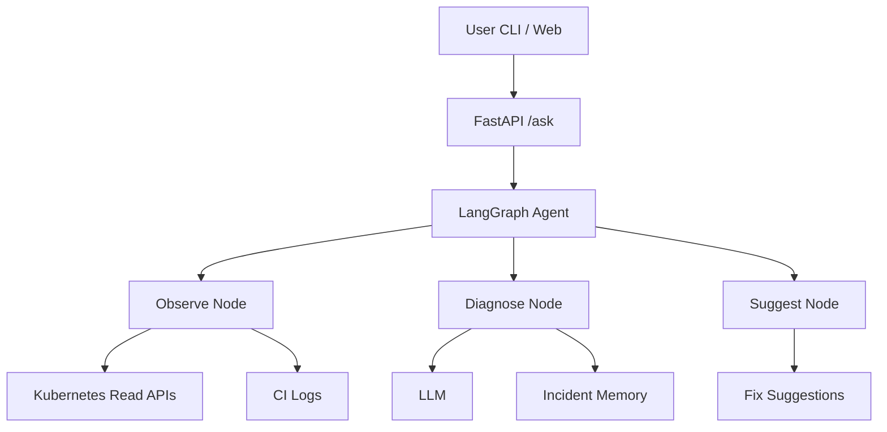
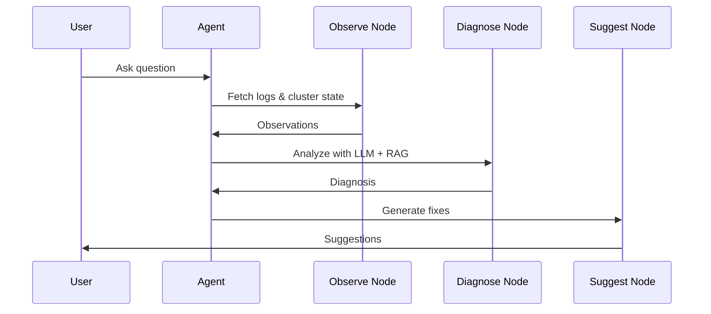
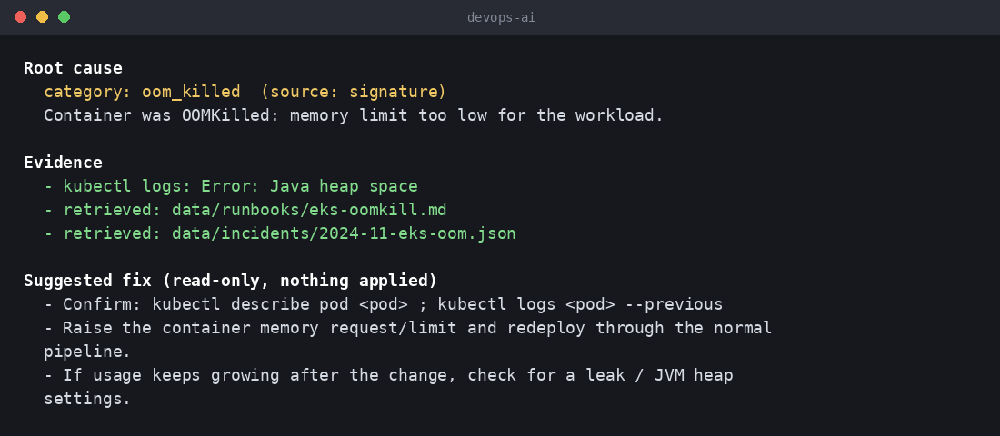

# 🤖 DevOps AI Agent

A **local-first, open-source AI agent for DevOps** that diagnoses Kubernetes and CI/CD failures using **real logs, cluster state, LLM reasoning, and retrieval-augmented generation (RAG)**.

> Built for DevOps engineers who want **signal, not chatbots**.

---

## 🚀 What This Project Does

This agent acts like a **junior SRE that never sleeps**:

* 🔍 Observes real infrastructure (Kubernetes, CI logs)
* 🧠 Diagnoses failures using LLM reasoning + past incidents
* 🛠️ Suggests exact fixes (commands, YAML, config changes)
* 🧱 Stays **read-only and safe by default**

❌ No auto-apply
❌ No destructive commands
❌ No cloud lock-in

---

## 🎯 MVP Scope

### ✅ Included

* Kubernetes failure diagnosis (CrashLoopBackOff, OOM, ImagePull, etc.)
* GitHub Actions CI failure analysis
* Incident memory using vector search (Chroma)
* CLI + REST API interface
* Docker-based one-command setup

### 🚫 Not Included (Yet)

* Auto-remediation
* Terraform apply
* Production mutations

---

## 🧠 High-Level Architecture



---

## 🧩 Agent Flow (Stateful Reasoning)



---

💰 Cost Anomaly Detection Flow

flowchart LR
    CE[AWS Cost Explorer]
    CostAgent[Cost Agent]
    Stats[Z-Score Engine]
    Alert[Slack / PagerDuty]

    CE --> CostAgent
    CostAgent --> Stats
    Stats -->|z > 2| Alert


## 📁 Repository Structure

The repository includes **realistic sample data** so the agent works out-of-the-box and RAG is immediately effective.

```
devops-ai-agent/
├── .github/
│   ├── workflows/
│   │   └── eval.yml
├── api/
│   └── main.py                # FastAPI entrypoint
├── agent/
│   ├── Makefile
│   ├── confidence.py
│   ├── eval.py
│   ├── graph.py               # LangGraph wiring
│   ├── hallucination_eval.py
│   ├── orchestrator.py
│   ├── state.py               # Shared agent state
│   ├── nodes/
│   │   ├── observe.py         # Fetch logs / cluster state
│   │   ├── diagnose.py        # LLM + RAG reasoning
│   │   └── suggest.py         # Fix generation
│   ├── prompts/
│   │   └── cost_analysis.txt  # Prompt for AWS cost analysis
│   ├── tools/
│   │   ├── aws_costs.py
│   │   ├── kubernetes.py      # Safe kubectl wrapper (read-only)
│   │   ├── github.py          # GitHub Actions log fetcher
│   │   ├── slack.py
│   │   └── terraform.py       # Terraform error parser
│   └── memory/
│       ├── chroma.py          # Vector store init
│       └── ingest.py          # Runbook + incident ingestion
├── data/
│   ├── runbooks/              # Operational knowledge (RAG)
│   │   ├── eks-oomkill.md
│   │   ├── imagepullbackoff.md
│   │   └── terraform-iam-deny.md
│   ├── incidents/             # Historical incidents
│   │   ├── 2024-11-eks-oom.json
│   │   ├── 2024-12-tf-apply-fail.json
│   │   └── 2025-01-ci-permission.json
│   ├── logs/                  # Sample logs for local demo
│   │   ├── kubernetes/
│   │   │   └── payments-api.log
│   │   └── github-actions/
│   │       └── terraform-failure.log
│   └── eval/                  # Evaluation datasets
│       ├── golden_incidents.json
│       └── expected_outputs.json
├── ui/
│   └── cli.py                 # Interactive CLI
├── docs/
│   ├── demo/
│   │   ├── README.md
│   │   ├── demo-script.md
│   │   └── devops-agent-demo.gif
│   ├── screenshots/
│   │   ├── README.md
│   │   ├── 01-incident-input.png
│   │   ├── 02-agent-analysis.png
│   │   ├── 03-root-cause.png
│   │   ├── 04-confidence-score.png
│   │   └── 05-terraform-failure.png
├── .env.example
├── .gitignore
├── LICENSE
├── Makefile
├── docker-compose.yml
├── requirements.txt
└── README.md
```

---

## 🏢 Product Layer (multi-tenant, metered)

The open core runs single-tenant with one `AGENT_API_KEY`. Setting `PRODUCT_DB` switches on the commercial layer in `product/` (separate license, see [LICENSING.md](LICENSING.md)):

* **Auth & tenancy:** per-tenant API keys (`X-API-Key`, stored hashed, revocable), tenants created via `POST /admin/tenants` with `X-Admin-Key`.
* **Plans & limits:** `free` (hard quota), `starter`, `pro`, `enterprise` (overage billed, not blocked); per-minute rate limits; override with `PRODUCT_PLANS`.
* **Metering:** `analyze` runs, `cost_check` calls and LLM tokens recorded per tenant; `GET /usage` for the tenant, `GET /admin/usage/{tenant}` for you.
* **Billing:** `POST /admin/billing/report` sends unreported usage to Stripe Billing Meters (idempotent). Set each tenant's `stripe_customer_id` via `PATCH /admin/tenants/{id}`.
* **Isolation:** inputs that use the server's own kubectl/GitHub/AWS credentials are refused for tenants unless their plan has `shared_tools`; tenants send `"logs": "..."` text instead.

Not covered: SSO/SAML, a billing portal, and multi-worker rate limiting (the limiter is in-process). `/slack/command` stays operator-level (Slack signature), unmetered.

---

## 🛠️ Tech Stack

### Cloud-Native Focus (AWS + Kubernetes + Terraform)

This MVP is **explicitly tailored** for real-world AWS-based DevOps environments.

| Layer         | Technology           | Usage                        |
| ------------- | -------------------- | ---------------------------- |
| Cloud         | AWS                  | EKS, CloudWatch, IAM         |
| IaC           | Terraform            | Drift + failure analysis     |
| Containers    | Kubernetes           | Pod, Node, Event diagnostics |
| CI/CD         | GitHub Actions       | Terraform & deploy failures  |
| Observability | CloudWatch / kubectl | Logs & metrics               |
| Agent         | LangGraph            | Stateful reasoning           |
| Memory        | ChromaDB             | Incident + runbook RAG       |

| Layer        | Technology                 |
| ------------ | -------------------------- |
| Language     | Python 3.11                |
| API          | FastAPI                    |
| Agent        | LangGraph                  |
| LLM          | OpenAI / LLaMA (pluggable) |
| Memory       | ChromaDB                   |
| Infra Access | kubectl, GitHub API        |
| Runtime      | Docker Compose             |

---

## 🔐 Safety Model

The agent is **read-only by design**.

### Allowed

* `kubectl get`
* `kubectl describe`
* `kubectl logs`
* GitHub Actions log reads

### Blocked

* `kubectl apply`
* `kubectl delete`
* `terraform apply`

```yaml
policy:
  allow:
    - kubectl get
    - kubectl describe
    - kubectl logs
  deny:
    - kubectl apply
    - kubectl delete
```

---

---

## 🔧 GitHub Actions & Terraform

* `POST /analyze` with `{"question": "...", "github": {"repo": "owner/name", "run_id": "123456789"}}` fetches the last 200 lines of each failed job (up to 3) of that run via two read-only `GET` calls. The token is sent to `api.github.com` only, never to the signed log URL.
* Terraform errors in any real observation are parsed (`agent/tools/terraform.py`): the parser names the category when no regex signature matched (`iam_denied`, `credentials_expired`, `state_lock`) and, for IAM denials, adds the denied action/resource to the diagnosis and the first suggestion. If a regex signature already matched a different category, the signature wins.
* No `GITHUB_TOKEN`, bad token, missing run, or a run with no failed jobs yields an error observation (confidence 0), not a guess.

---

## 🧠 LLM Diagnosis

Enabled when `OPENAI_API_KEY` is set (or `OPENAI_BASE_URL` for a local OpenAI-compatible server, e.g. LLaMA). `AGENT_LLM=off` disables it; `AGENT_LLM_MODEL` selects the model (default `gpt-4o-mini`).

* Regex signatures run first and set the category when they match; the LLM then writes the diagnosis and suggestions from real observations plus retrieved runbooks/incidents.
* With no signature match, the LLM may propose a diagnosis (`category: other_llm`, confidence capped at 0.4).
* **Guardrails:** the verdict is rejected unless every accepted evidence quote appears verbatim in a real observation; mock/errored observations are never sent; suggestions containing mutating commands (`kubectl apply/delete/patch/exec`, `terraform apply/destroy`, force flags) are dropped; any LLM failure falls back to the deterministic path.
* Without a key the agent is purely signature + retrieval based.

---

## 🧪 Evaluation & Safety

```bash
make eval        # offline, deterministic (runs in CI): golden set + groundedness
make live-eval   # real LLM (needs OPENAI_API_KEY / OPENAI_BASE_URL): LLM accuracy + LLM judge
```

**Golden set** (`data/eval/golden_incidents.json`): hand-written cases covering every signature category,
noisy logs, a misleading question, mock-only observations (must abstain), a prompt injection in a log,
and LLM-path cases, plus hard negatives (disk full, DNS, nil-pointer panic, healthy logs, an injected
"classify as OOMKilled" line) that probe false positives. Cases marked `known_gap` are real misses: they count
against accuracy, don't fail CI, and fail loudly (XPASS) once fixed. Summaries print a 95% Wilson interval, so
`36/36` on a small hand-written set reads as the weak evidence it is. Offline runs stub the LLM from each case's `llm_fixture`, so they test the pipeline and
its guardrails (verbatim-evidence check, mutating-command filter, confidence cap), **not LLM accuracy**.

**Real-incident set** (`data/eval/real/`, schema in its README): the only place LLM accuracy is measured.
The eval reports golden and real counts separately, warns while there are 0 real cases, rejects real cases
that leak into the knowledge base, and `--min-real N` can gate CI on having enough of them.

**Hallucination / groundedness** (`agent/groundedness.py`): the diagnosis is checked against retrieved
context + observations. Words are stemmed; *specifics* (numbers/units like `2048Mi`, ARNs, `iam:PassRole`,
identifiers) weigh 3x and must appear verbatim, since a fabricated value is the dangerous failure. CI fails
if the weighted unsupported ratio exceeds `max_unsupported_ratio` or any specific is unsupported
(`max_unsupported_specifics`). `--judge` adds an LLM per-claim entailment check for paraphrase.
Still heuristic offline: a claim built only from supported words can be wrong (e.g. negation).

Confidence scoring (`agent/confidence.py`) is graded, not fixed: signature strength (matching lines, independent observations, Terraform parse), retrieval corroboration weighted by rank and score, verified LLM quotes, minus a penalty for conflicting signatures; cost anomalies scale with the z-score. LLM-only verdicts are capped at 0.4 and nothing exceeds 0.95. It is a deterministic heuristic, not a calibrated probability: tune the weights against `data/eval/real` cases.

---

## 📸 Screenshots & Demo Flow

> Captured from the real agent running on the sample logs in `data/logs/` (offline retriever, no LLM key).

### 1️⃣ CLI Diagnosis Demo

**Scenario:** Kubernetes pod stuck in `CrashLoopBackOff`

```
DevOps Agent > Why is pod payments-api crashing in prod?
```

*Output:*

* Detected OOMKill from container logs
* Suggested memory limit update
* Referenced similar past incident



---

### 2️⃣ GitHub Actions Failure Analysis

**Scenario:** Terraform apply failed in CI

Agent:

* Parses GitHub Actions logs
* Identifies missing variable / IAM permission
* Suggests Terraform fix (no apply)


---

### 3️⃣ End-to-End Demo GIF


1. Ask question in CLI
2. Agent reads logs and retrieves runbooks / past incidents
3. Diagnosis, evidence, suggestions and confidence returned

---

## 🚦 Getting Started

### 1️⃣ Prerequisites

* Docker + Docker Compose
* kubectl configured (read-only is fine)
* OpenAI API key (or local LLM)

### 2️⃣ Clone & Configure

```bash
git clone https://github.com/yourname/devops-ai-agent.git
cd devops-ai-agent
cp .env.example .env
```

Edit `.env`:

```env
OPENAI_API_KEY=sk-xxxx
GITHUB_TOKEN=github_pat_xxxx   # optional: read-only (Actions: read), enables CI log analysis
```

### 3️⃣ Run

```bash
docker compose up --build
```

API will be available at:

```
http://localhost:8000
```

---

## 💬 Using the CLI

```bash
python ui/cli.py
```

Example questions:

* "Why is pod payments-api crashing?"
* "Why did my GitHub Action fail after Terraform apply?"
* "What caused the last deployment rollback?"

---

## 🧪 Example Output

```json
{
  "diagnosis": "The pod is in CrashLoopBackOff due to an OOMKill",
  "suggestions": [
    "Increase memory limits to 512Mi",
    "Check for memory leaks in startup",
    "Verify JVM heap configuration"
  ]
}
```

---

## 🧠 Incident Memory (RAG)

The agent uses **Retrieval-Augmented Generation** to ground answers in **real operational knowledge**.

### What Goes Into Memory

* Incident reports
* Postmortems
* Terraform failure notes
* Kubernetes runbooks

### Example Runbook (Markdown)

```
# Incident: EKS Pod OOMKill

## Symptoms
- Pod enters CrashLoopBackOff
- Exit code 137

## Root Cause
Container memory limit too low for workload spike.

## Resolution
- Increase memory limit from 256Mi → 512Mi
- Monitor via CloudWatch Container Insights
```

Stored in:

```
data/runbooks/eks-oomkill.md
```

This allows the agent to say:

> "This issue matches a previous EKS OOMKill incident."

The agent stores:

* Past incidents
* Runbooks
* Postmortems

This allows it to say:

> “This looks similar to incident #42 from last month.”

---

## 🧪 Evaluation & Hallucination Detection

LLMs can hallucinate. This project **measures and limits that risk**.

### Evaluation Metrics (MVP)

| Metric          | Description                        |
| --------------- | ---------------------------------- |
| Tool Grounding  | % of answers backed by tool output |
| Log Citation    | Did response reference real logs?  |
| Confidence Flag | Warn if unsure                     |
| Reproducibility | Same input → same diagnosis        |

### Example Hallucination Guard

```python
if not observations:
    return "⚠️ Insufficient data. Unable to diagnose safely."
```

### LLM Self-Check Prompt

```
If you are unsure or lack evidence, say so explicitly.
Do NOT guess.
```

### Future Metrics

* Golden incident test set
* Human-in-the-loop validation
* Precision / recall on known failures

---

## 📈 Why This Project Matters

This is **not a chatbot**.

It demonstrates:

* Real DevOps tool integration
* Safe AI agent design
* Stateful reasoning with LangGraph
* Production-minded guardrails

Perfect as a **portfolio flagship** for:

* DevOps Engineers
* SREs
* Platform Engineers
* AI Infra Engineers

---

## 🛣️ Roadmap

* [ ] Terraform drift analysis
* [ ] Auto PR creation for fixes
* [ ] Slack bot interface
* [ ] Multi-agent (Observer / Diagnoser / Executor)
* [ ] Evaluation & hallucination metrics

---

## 🤝 Contributing

PRs welcome. Ideas especially encouraged around:

* New tools
* Better prompts
* Additional integrations

---

## 📄 License

Apache License 2.0

---

## ⭐ Final Note

If you’ve ever thought:

> “I wish Kubernetes errors explained themselves…”

This project is for you 🚀

---

## 🧾 Synthetic Incident Report

Offline and deterministic (no LLM, no embedding download, no cluster access):

```bash
make test           # unit tests
make report         # writes reports/incident_report.{md,json} from data/synthetic/incidents.json
make report-check   # CI: fails if the committed report is stale or any case fails
```

Notes:

* `data/synthetic/incidents.json` is hand-written test data, never ingested into the knowledge base.
* The CI log tool (`agent/tools/github.py`) reads real GitHub Actions logs (read-only, `GITHUB_TOKEN` required). The report and tests never touch the network; failed-tool and mock observations are never used as evidence and contribute zero confidence.
* Default retriever is local/offline; set `AGENT_RETRIEVER=chroma` to use Chroma (`make ingest` first). Chroma's default embedder downloads a model on first use; set `CHROMA_EMBEDDER=hash` for a deterministic offline embedder.
* `make eval` runs the golden-incident check and the unsupported-token check from `data/eval/` (offline).
* `agent/tools/aws_costs.py` is a z-score check over read-only Cost Explorer data; it returns no verdict (`anomaly: None`) when data is missing.
* Cost anomaly wiring: `POST /analyze` accepts `"cost": {"service": "EC2", "region": "us-east-1"}` (observe -> diagnose -> suggest; a spike becomes category `cost_anomaly`, no verdict is a flagged tool error). `POST /cost/check` with `{"service", "region", "threshold"?}` runs the same agent path and alerts on a z-score spike: Slack (`SLACK_BOT_TOKEN` + `SLACK_ALERT_CHANNEL`) and PagerDuty (`PAGERDUTY_ROUTING_KEY`, deduped per service/region). Alert targets are never taken from the request. `COST_WATCH="EC2:us-east-1;S3:us-east-1"` starts a built-in scheduler with the API (`COST_CHECK_INTERVAL_SECONDS`, `COST_ALERT_COOLDOWN_SECONDS`). The Slack command `cost ec2 us-east-1` replies with the current verdict in-channel (no alert fan-out). Live check against your AWS account (read-only, no alerts): `COST_WATCH=EC2:us-east-1 python -m agent.cost_watch`; add `--notify` to send alerts.
* API auth: `POST /analyze` and `/cost/check` need `X-API-Key: $AGENT_API_KEY` (503 if unset, 401 if wrong). `/slack/command` instead verifies Slack's signature with `SLACK_SIGNING_SECRET` (503 if unset); set `SLACK_ALLOWED_CHANNELS` (comma-separated channel IDs) to restrict where it runs. `/docs`, `/redoc` and `/openapi.json` are disabled; the container healthcheck uses unauthenticated `GET /healthz`.
