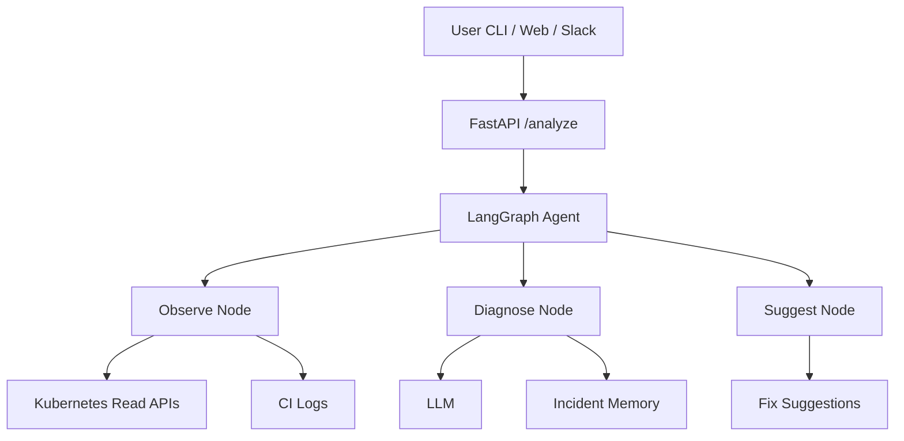
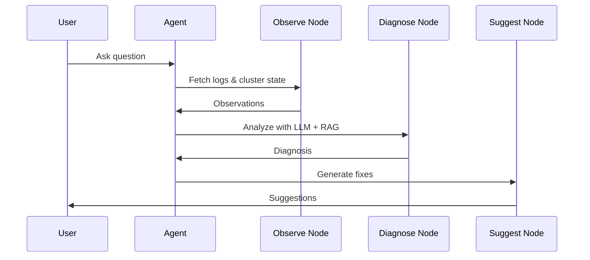
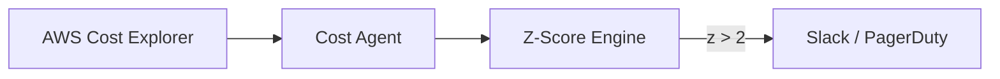
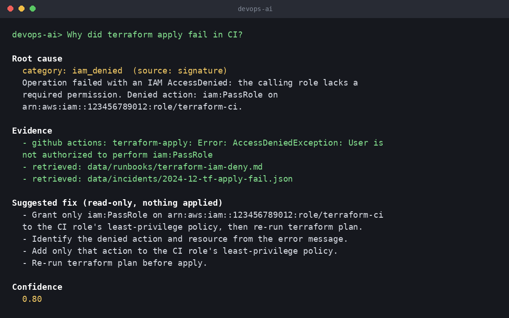
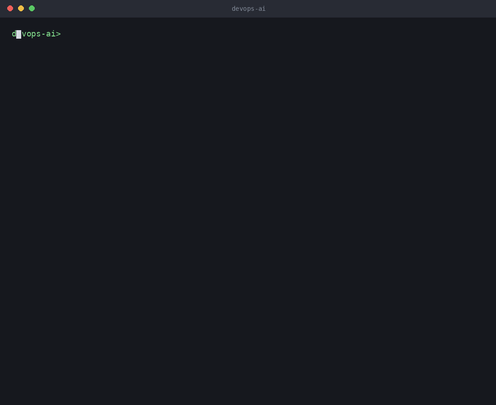

# 🤖 DevOps AI Agent

A **local-first, open-source AI agent for DevOps** that diagnoses Kubernetes and CI/CD failures using **real logs, cluster state, LLM reasoning, and retrieval-augmented generation (RAG)**.

> Built for DevOps engineers who want **signal, not chatbots**.

---

## 🚀 What This Project Does

This agent acts like a **junior SRE that never sleeps**:

* 🔍 Observes real infrastructure (Kubernetes, CI logs)
* 🧠 Diagnoses failures using LLM reasoning + past incidents
* 🛠️ Suggests exact fixes (commands, YAML, config changes)
* 🧱 Stays **read-only and safe by default**

❌ No auto-apply
❌ No destructive commands
❌ No cloud lock-in

---

## 🎯 MVP Scope

### ✅ Included

* Kubernetes failure diagnosis (CrashLoopBackOff, OOM, ImagePull, etc.)
* GitHub Actions CI failure analysis and Terraform error parsing
* AWS cost anomaly detection with Slack / PagerDuty alerts
* Incident memory using vector search (Chroma)
* CLI, REST API and Slack slash-command interface
* Docker-based one-command setup

### 🚫 Not Included (Yet)

* Auto-remediation
* Terraform apply
* Production mutations

---

## 🧠 High-Level Architecture



---

## 🧩 Agent Flow (Stateful Reasoning)



---

## 💰 Cost Anomaly Detection Flow




## 📁 Repository Structure

The repository includes **realistic sample data** so the agent works out-of-the-box and RAG is immediately effective.

```
agentic-devops/
├── .github/workflows/eval.yml  # CI: tests, offline eval, report check
├── api/
│   └── main.py                # FastAPI: /analyze, /cost/check, /slack/command, /healthz (+ product routes)
├── agent/
│   ├── Makefile
│   ├── confidence.py
│   ├── cost_watch.py          # Built-in cost scheduler / live check
│   ├── eval.py
│   ├── graph.py               # LangGraph wiring
│   ├── groundedness.py
│   ├── hallucination_eval.py
│   ├── llm.py                 # OpenAI-compatible client + guardrails
│   ├── orchestrator.py
│   ├── real_case.py
│   ├── report.py              # Synthetic incident report
│   ├── signatures.py          # Regex failure signatures
│   ├── state.py               # Shared agent state
│   ├── nodes/
│   │   ├── observe.py         # Fetch logs / cluster state
│   │   ├── diagnose.py        # LLM + RAG reasoning
│   │   └── suggest.py         # Fix generation
│   ├── prompts/
│   │   └── cost_analysis.txt  # Prompt for AWS cost analysis
│   ├── tools/
│   │   ├── aws_costs.py
│   │   ├── kubernetes.py      # Safe kubectl wrapper (read-only)
│   │   ├── github.py          # GitHub Actions log fetcher
│   │   ├── slack.py
│   │   └── terraform.py       # Terraform error parser
│   └── memory/
│       ├── chroma.py          # Vector store init
│       ├── ingest.py          # Runbook + incident ingestion
│       └── retrieval.py       # Local (default) and Chroma retrievers
├── product/                   # Commercial layer (separate license, see LICENSING.md)
├── data/
│   ├── runbooks/              # Operational knowledge (RAG)
│   ├── incidents/             # Historical incidents
│   ├── logs/                  # Sample logs for local demo
│   ├── eval/                  # Golden set + real-incident set
│   └── synthetic/             # Hand-written report dataset (never ingested)
├── reports/                   # Generated synthetic incident report
├── tests/
├── ui/
│   └── cli.py                 # Interactive CLI
├── docs/
│   ├── demo/                  # Demo script + GIF
│   └── screenshots/
├── .dockerignore
├── .env.example
├── .gitignore
├── Dockerfile
├── Dockerfile.product         # Commercial image (adds product/)
├── LICENSE
├── LICENSING.md
├── Makefile
├── docker-compose.yml
├── docker-compose.kube.yml    # Opt-in kubeconfig / AWS mounts for kubectl logs
├── pytest.ini
├── requirements.txt
└── README.md
```

---

## 🏢 Product Layer (multi-tenant, metered)

The open core runs single-tenant with one `AGENT_API_KEY`. Setting `PRODUCT_DB` switches on the commercial layer in `product/` (separate license, see [LICENSING.md](LICENSING.md)):

* **Auth & tenancy:** per-tenant API keys (`X-API-Key`, stored hashed, revocable), tenants created via `POST /admin/tenants` with `X-Admin-Key`.
* **Plans & limits:** `free` (hard quota), `starter`, `pro`, `enterprise` (overage billed, not blocked); per-minute rate limits; override with `PRODUCT_PLANS`.
* **Metering:** `analyze` runs, `cost_check` calls and LLM tokens recorded per tenant; `GET /usage` for the tenant, `GET /admin/usage/{tenant}` for you.
* **Billing:** `POST /admin/billing/report` sends unreported usage to Stripe Billing Meters (idempotent). `PATCH /admin/tenants/{id}` can still override `stripe_customer_id`/`plan` by hand.
* **Subscriptions:** creating a tenant creates its Stripe customer (when `STRIPE_SECRET_KEY` is set). Tenants self-serve with `POST /billing/checkout {"plan": "pro"}` (returns a Stripe Checkout URL) and `POST /billing/portal` (card, plan change, cancel); `POST /admin/tenants/{id}/checkout` does the same for you. Point a Stripe webhook at `POST /stripe/webhook` (events: `checkout.session.completed`, `customer.subscription.created|updated|deleted`, `invoice.payment_failed`). The plan follows the subscription's price (`STRIPE_PRICE_<PLAN>`); the first failed payment drops the tenant to `free` immediately (Stripe keeps retrying, and a successful retry restores the paid plan); cancellation, `unpaid` or exhausted retries also end the subscription. Webhooks are signature-verified and idempotent per event id.
* **Isolation:** inputs that use the server's own kubectl/GitHub/AWS credentials are refused for tenants unless their plan has `shared_tools`; tenants send `"logs": "..."` text instead.

* **Self-serve (`product/web.py`):** `GET /pricing` (plans, included usage, prices, upgrade buttons only for plans Stripe can actually sell), `GET /signup` + `POST /signup {"name": "...", "email": "..."}` (public; creates a `free` tenant and returns its API key once, no Stripe call), `GET /recover` (lost key, below), and `GET /account` (paste your key: plan, usage, **Upgrade** via Checkout, **Manage billing** via the Stripe portal; backed by `GET /billing`). Pages ship a nonce-based CSP, no cookies, and keep the key in `sessionStorage` only.
  * **Signup is closed until you open it** with `PRODUCT_SIGNUP=on`: every free account can spend the server's LLM tokens, so that is your call. While it is closed `POST /signup` answers 403, `/pricing` sends existing customers to `/account` to upgrade, and you still create tenants with `POST /admin/tenants`. Once open it is rate limited per IP and per day (`PRODUCT_SIGNUP_PER_IP_HOUR`, `PRODUCT_SIGNUP_PER_DAY`) and trusts `X-Forwarded-For` only with `PRODUCT_TRUST_PROXY=1`. Emails are unique per tenant; a repeat signup gets a 409.
  * **Prices come from Stripe.** For each purchasable plan, `/pricing` reads the prices in `STRIPE_PRICE_<PLAN>` and shows e.g. `$49 / month` or `$99 / month + usage`. Lookups are cached for an hour, a Stripe failure backs off for a minute (the page keeps loading and says "Shown at checkout"), and tiered, customer-chosen, mixed-currency or one-time prices show no figure rather than a wrong one. A `price_label` for the plan in `PRODUCT_PLANS` overrides the lookup. `PRODUCT_CONTACT_URL` is where plans that are not sold online (e.g. enterprise) point.
  * **Lost keys are recoverable by email.** Signup requires an email (the only way back in, stored lower-cased; operators may omit it on `POST /admin/tenants`). `POST /recover {"email"}` always answers 202, whether or not the address is registered, and mails a one-time link that is valid for 30 minutes (one email per tenant per 10 minutes, per-IP and daily limits via `PRODUCT_RECOVER_PER_IP_HOUR` / `PRODUCT_RECOVER_PER_DAY`). The link opens `/recover`, and its button calls `POST /recover/confirm`, which **revokes every existing key of the tenant** and shows one new key once; opening the link alone never spends it, and the token travels in the URL fragment so it is not sent to the server or logged. Recovery needs `PRODUCT_SMTP_HOST`, `PRODUCT_SMTP_FROM` and `PRODUCT_PUBLIC_URL` (links are built from that URL, never from the request's `Host` header); without them `/recover` answers 503. Operators can always find a tenant with `GET /admin/tenants?email=…` and issue a key with `POST /admin/tenants/{id}/keys`. The email is not verified at signup, so an address can be claimed by whoever signs up with it first.

Rate limits are stored in the product DB, so they hold across workers. `/slack/command` is metered too: link a workspace with `PUT /admin/tenants/{id}/slack {"team_id": "T…"}` (unlinked workspaces are refused); its rate limit, quota and shared-tool grant then apply as on the HTTP API (`cost …` needs `shared_tools`).

Not covered: SSO/SAML, seat-based pricing, proration previews, and email verification for self-serve signups.

---

## 🛠️ Tech Stack

### Cloud-Native Focus (AWS + Kubernetes + Terraform)

This MVP is **explicitly tailored** for real-world AWS-based DevOps environments.

| Layer         | Technology           | Usage                        |
| ------------- | -------------------- | ---------------------------- |
| Cloud         | AWS                  | EKS, CloudWatch, IAM         |
| IaC           | Terraform            | Drift + failure analysis     |
| Containers    | Kubernetes           | Pod, Node, Event diagnostics |
| CI/CD         | GitHub Actions       | Terraform & deploy failures  |
| Observability | CloudWatch / kubectl | Logs & metrics               |
| Agent         | LangGraph            | Stateful reasoning           |
| Memory        | ChromaDB             | Incident + runbook RAG       |

| Layer        | Technology                 |
| ------------ | -------------------------- |
| Language     | Python 3.11                |
| API          | FastAPI                    |
| Agent        | LangGraph                  |
| LLM          | OpenAI / LLaMA (pluggable) |
| Memory       | ChromaDB                   |
| Infra Access | kubectl, GitHub API        |
| Runtime      | Docker Compose             |

---

## 🔐 Safety Model

The agent is **read-only by design**.

### Allowed

* `kubectl get`
* `kubectl describe`
* `kubectl logs`
* GitHub Actions log reads

### Blocked

* `kubectl apply`
* `kubectl delete`
* `terraform apply`

```yaml
policy:
  allow:
    - kubectl get
    - kubectl describe
    - kubectl logs
  deny:
    - kubectl apply
    - kubectl delete
```

---

---

## 🔧 GitHub Actions & Terraform

* `POST /analyze` with `{"question": "...", "github": {"repo": "owner/name", "run_id": "123456789"}}` fetches the last 200 lines of each failed job (up to 3) of that run via two read-only `GET` calls. The token is sent to `api.github.com` only, never to the signed log URL.
* Terraform errors in any real observation are parsed (`agent/tools/terraform.py`): the parser names the category when no regex signature matched (`iam_denied`, `credentials_expired`, `state_lock`) and, for IAM denials, adds the denied action/resource to the diagnosis and the first suggestion. If a regex signature already matched a different category, the signature wins.
* No `GITHUB_TOKEN`, bad token, missing run, or a run with no failed jobs yields an error observation (confidence 0), not a guess.

---

## 🧠 LLM Diagnosis

Enabled when `OPENAI_API_KEY` is set (or `OPENAI_BASE_URL` for a local OpenAI-compatible server, e.g. LLaMA). `AGENT_LLM=off` disables it; `AGENT_LLM_MODEL` selects the model (default `gpt-4o-mini`).

* Regex signatures run first and set the category when they match; the LLM then writes the diagnosis and suggestions from real observations plus retrieved runbooks/incidents.
* With no signature match, the LLM may propose a diagnosis (`category: other_llm`, confidence capped at 0.4).
* **Guardrails:** the verdict is rejected unless every accepted evidence quote appears verbatim in a real observation; mock/errored observations are never sent; suggestions containing mutating commands (`kubectl apply/delete/patch/exec`, `terraform apply/destroy`, force flags) are dropped; any LLM failure falls back to the deterministic path.
* Without a key the agent is purely signature + retrieval based.

---

## 🧪 Evaluation & Safety

```bash
make eval        # offline, deterministic (runs in CI): golden set + groundedness
make live-eval   # real LLM (needs OPENAI_API_KEY / OPENAI_BASE_URL): LLM accuracy + LLM judge
```

**Golden set** (`data/eval/golden_incidents.json`): hand-written cases covering every signature category,
noisy logs, a misleading question, mock-only observations (must abstain), a prompt injection in a log,
and LLM-path cases, plus hard negatives (disk full, DNS, nil-pointer panic, healthy logs, an injected
"classify as OOMKilled" line) that probe false positives. Cases marked `known_gap` are real misses: they count
against accuracy, don't fail CI, and fail loudly (XPASS) once fixed. Summaries print a 95% Wilson interval, so
`36/36` on a small hand-written set reads as the weak evidence it is. Offline runs stub the LLM from each case's `llm_fixture`, so they test the pipeline and
its guardrails (verbatim-evidence check, mutating-command filter, confidence cap), **not LLM accuracy**.

**Real-incident set** (`data/eval/real/`, schema in its README): the only place LLM accuracy is measured.
The eval reports golden and real counts separately, warns while there are 0 real cases, rejects real cases
that leak into the knowledge base, and `--min-real N` can gate CI on having enough of them.

**Hallucination / groundedness** (`agent/groundedness.py`): the diagnosis is checked against retrieved
context + observations. Words are stemmed; *specifics* (numbers/units like `2048Mi`, ARNs, `iam:PassRole`,
identifiers) weigh 3x and must appear verbatim, since a fabricated value is the dangerous failure. CI fails
if the weighted unsupported ratio exceeds `max_unsupported_ratio` or any specific is unsupported
(`max_unsupported_specifics`). `--judge` adds an LLM per-claim entailment check for paraphrase.
Still heuristic offline: a claim built only from supported words can be wrong (e.g. negation).

Confidence scoring (`agent/confidence.py`) is graded, not fixed: signature strength (matching lines, independent observations, Terraform parse), retrieval corroboration weighted by rank and score, verified LLM quotes, minus a penalty for conflicting signatures; cost anomalies scale with the z-score. LLM-only verdicts are capped at 0.4 and nothing exceeds 0.95. It is a deterministic heuristic, not a calibrated probability: tune the weights against `data/eval/real` cases.

---

## 📸 Screenshots & Demo Flow

> Captured from the real agent running on the sample logs in `data/logs/` (offline retriever, no LLM key).

### 1️⃣ CLI Diagnosis Demo

**Scenario:** Kubernetes pod stuck in `CrashLoopBackOff`

```
DevOps Agent > Why is pod payments-api crashing in prod?
```

*Output:*

* Detected OOMKill from container logs
* Suggested memory limit update
* Referenced similar past incident


---

### 2️⃣ GitHub Actions Failure Analysis

**Scenario:** Terraform apply failed in CI

Agent:

* Parses GitHub Actions logs
* Identifies missing variable / IAM permission
* Suggests Terraform fix (no apply)



---

### 3️⃣ End-to-End Demo GIF



1. Ask question in CLI
2. Agent reads logs and retrieves runbooks / past incidents
3. Diagnosis, evidence, suggestions and confidence returned

---

## 🚦 Getting Started

### 1️⃣ Prerequisites

* Docker + Docker Compose
* kubectl configured (read-only is fine)
* Optional: OpenAI API key or a local OpenAI-compatible server (without one the agent runs in deterministic mode)
* Optional: kubectl / AWS credentials (see `docker-compose.kube.yml`)

### 2️⃣ Clone & Configure

```bash
git clone <your-fork-or-repo-url> agentic-devops
cd agentic-devops
cp .env.example .env
```

Edit `.env`:

```env
AGENT_API_KEY=...              # required for POST /analyze and /cost/check (python -c "import secrets; print(secrets.token_urlsafe(32))")
OPENAI_API_KEY=sk-xxxx         # optional: enables LLM diagnosis
GITHUB_TOKEN=github_pat_xxxx   # optional: read-only (Actions: read), enables CI log analysis
```

### 3️⃣ Run

```bash
docker compose up --build        # or: make up
```

To let the agent run `kubectl logs` against your cluster, add the opt-in override:
`docker compose -f docker-compose.yml -f docker-compose.kube.yml up --build`.

API will be available at:

```
http://localhost:8000
```

---

## 💬 Using the CLI

```bash
pip install -r requirements.txt
python ui/cli.py
```

Example questions:

* "Why is pod payments-api crashing?"
* "Why did my GitHub Action fail after Terraform apply?"
* "What caused the last deployment rollback?"

---

## 🧪 Example Output

```json
{
  "diagnosis": "The pod is in CrashLoopBackOff due to an OOMKill",
  "suggestions": [
    "Increase memory limits to 512Mi",
    "Check for memory leaks in startup",
    "Verify JVM heap configuration"
  ]
}
```

---

## 🧠 Incident Memory (RAG)

The agent uses **Retrieval-Augmented Generation** to ground answers in **real operational knowledge**.

### What Goes Into Memory

* Incident reports
* Postmortems
* Terraform failure notes
* Kubernetes runbooks

### Example Runbook (Markdown)

```
# Incident: EKS Pod OOMKill

## Symptoms
- Pod enters CrashLoopBackOff
- Exit code 137

## Root Cause
Container memory limit too low for workload spike.

## Resolution
- Increase memory limit from 256Mi → 512Mi
- Monitor via CloudWatch Container Insights
```

Stored in:

```
data/runbooks/eks-oomkill.md
```

This allows the agent to say:

> "This issue matches a previous EKS OOMKill incident."

The agent stores:

* Past incidents
* Runbooks
* Postmortems

This allows it to say:

> “This looks similar to incident #42 from last month.”

---

## 🧪 Evaluation & Hallucination Detection

See [Evaluation & Safety](#-evaluation--safety) above for the golden set, real-incident set and groundedness checks
(`make eval`, `make live-eval`). Open items: human-in-the-loop validation and precision/recall on real incidents
(`data/eval/real/`).

---

## 📈 Why This Project Matters

This is **not a chatbot**.

It demonstrates:

* Real DevOps tool integration
* Safe AI agent design
* Stateful reasoning with LangGraph
* Production-minded guardrails

Perfect as a **portfolio flagship** for:

* DevOps Engineers
* SREs
* Platform Engineers
* AI Infra Engineers

---

## 🛣️ Roadmap

* [x] Terraform failure parsing (IAM denial, expired credentials, state lock)
* [x] Slack slash-command interface (`/slack/command`)
* [x] Evaluation & hallucination metrics
* [x] Multi-tenant product layer (open-core split)
* [ ] Terraform drift analysis
* [ ] Auto PR creation for fixes
* [ ] Multi-agent (Observer / Diagnoser / Executor)
* [ ] Human-in-the-loop validation

---

## 🤝 Contributing

PRs welcome. Ideas especially encouraged around:

* New tools
* Better prompts
* Additional integrations

---

## 📄 License

Apache License 2.0 for the open core; `product/` is under a separate commercial license. See [LICENSING.md](LICENSING.md).

---

## ⭐ Final Note

If you’ve ever thought:

> “I wish Kubernetes errors explained themselves…”

This project is for you 🚀

---

## 🧾 Synthetic Incident Report

Offline and deterministic (no LLM, no embedding download, no cluster access):

```bash
make test           # unit tests
make report         # writes reports/incident_report.{md,json} from data/synthetic/incidents.json
make report-check   # CI: fails if the committed report is stale or any case fails
```

Notes:

* `data/synthetic/incidents.json` is hand-written test data, never ingested into the knowledge base.
* The CI log tool (`agent/tools/github.py`) reads real GitHub Actions logs (read-only, `GITHUB_TOKEN` required). The report and tests never touch the network; failed-tool and mock observations are never used as evidence and contribute zero confidence.
* Default retriever is local/offline; set `AGENT_RETRIEVER=chroma` to use Chroma (`make ingest` first). Chroma's default embedder downloads a model on first use; set `CHROMA_EMBEDDER=hash` for a deterministic offline embedder.
* `make eval` runs the golden-incident check and the unsupported-token check from `data/eval/` (offline).
* `agent/tools/aws_costs.py` is a z-score check over read-only Cost Explorer data; it returns no verdict (`anomaly: None`) when data is missing.
* Cost anomaly wiring: `POST /analyze` accepts `"cost": {"service": "EC2", "region": "us-east-1"}` (observe -> diagnose -> suggest; a spike becomes category `cost_anomaly`, no verdict is a flagged tool error). `POST /cost/check` with `{"service", "region", "threshold"?}` runs the same agent path and alerts on a z-score spike: Slack (`SLACK_BOT_TOKEN` + `SLACK_ALERT_CHANNEL`) and PagerDuty (`PAGERDUTY_ROUTING_KEY`, deduped per service/region). Alert targets are never taken from the request. `COST_WATCH="EC2:us-east-1;S3:us-east-1"` starts a built-in scheduler with the API (`COST_CHECK_INTERVAL_SECONDS`, `COST_ALERT_COOLDOWN_SECONDS`). The Slack command `cost ec2 us-east-1` replies with the current verdict in-channel (no alert fan-out). Live check against your AWS account (read-only, no alerts): `COST_WATCH=EC2:us-east-1 python -m agent.cost_watch`; add `--notify` to send alerts.
* API auth: `POST /analyze` and `/cost/check` need `X-API-Key: $AGENT_API_KEY` (503 if unset, 401 if wrong). `/slack/command` instead verifies Slack's signature with `SLACK_SIGNING_SECRET` (503 if unset); set `SLACK_ALLOWED_CHANNELS` (comma-separated channel IDs) to restrict where it runs. `/docs`, `/redoc` and `/openapi.json` are disabled; the container healthcheck uses unauthenticated `GET /healthz`.
